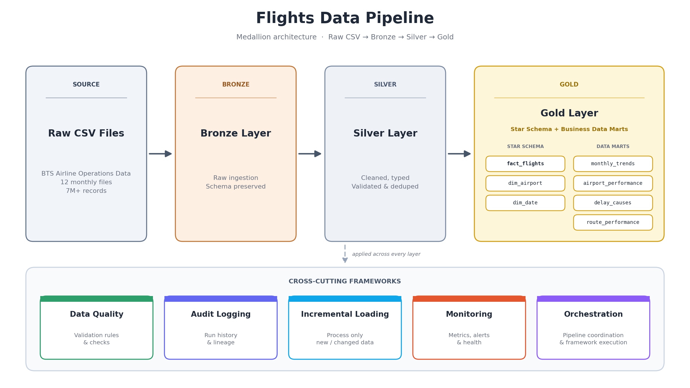

# ✈️ Airline Operations Lakehouse

A medallion-architecture data pipeline on Databricks (Delta Lake, PySpark) that turns **12 monthly U.S. flight-performance files (about 7 million rows)** into a star schema and analytics tables, with data quality gates, audit logging and run monitoring.

This is a learning project. I built it to practice the real mechanics of a pipeline: incremental loading, safe type casting, deduplication, dimensional modeling, quality gates and testing. The [limitations](#-limitations) section says plainly what it does not do.



---

## 📊 Results on the 2025 data

| Step                                     | Rows      |
| ---------------------------------------- | --------- |
| Raw CSV files loaded into Bronze         | 7,001,619 |
| Silver (after removing exact duplicates) | 6,972,326 |
| Gold fact table (one row per flight)     | 6,972,326 |

- 29,293 exact duplicate rows were removed in Silver.
- **22.31%** of completed flights arrived 15 or more minutes late.
- 16 automatic data quality checks run on every pipeline run. One known warning: a single completed flight has no arrival delay in the source file.

> **A bug I found and fixed.** The first version labelled cancelled flights as "on time", which pushed the delay rate down (22.01% instead of 22.31%). A cancelled flight has no arrival delay, so it now gets `IS_DELAYED = NULL` and is left out of delay rates. A test covers this case.

---

## 🧱 How the pipeline works

Dataset: U.S. DOT / Bureau of Transportation Statistics on-time performance data, 2025, 12 monthly CSV files.

| Layer      | What it does                                                                                                                                                                                                                | Table                   |
| ---------- | --------------------------------------------------------------------------------------------------------------------------------------------------------------------------------------------------------------------------- | ----------------------- |
| **Bronze** | Reads only **new or changed** files from the Databricks Volume, keeps every value as raw text, adds lineage (`_source_file`, `_ingested_at`). Re-running a file replaces its old rows, so a retry never creates duplicates. | `bronze.bronze_flights` |
| **Silver** | Converts text to dates and numbers with `try_cast` (a bad value becomes NULL instead of crashing the job), trims airport codes, adds `FLIGHT_STATUS`, `IS_DELAYED`, `DISTANCE_CATEGORY`, removes exact duplicate rows.      | `silver.silver_flights` |
| **Gold**   | Star schema plus four analytics tables built from it (see below).                                                                                                                                                           | `gold.*`                |

### Gold layer

| Table                                                                        | Description                                                                                                                         |
| ---------------------------------------------------------------------------- | ----------------------------------------------------------------------------------------------------------------------------------- |
| `fact_flights`                                                               | One row per flight. Keys: `DATE_KEY`, `ORIGIN`, `DEST`                                                                              |
| `dim_date`                                                                   | A full calendar (one row per day) with year, quarter, month, weekday and weekend flag                                               |
| `dim_airport`                                                                | One row per airport, built from **both** origin and destination columns (a role-playing dimension)                                  |
| `monthly_trends`, `airport_performance`, `route_performance`, `delay_causes` | Analytics tables. Delay rates use **completed flights only**, and use `try_divide` so an empty group gives NULL instead of an error |

---

## 🛡️ Operations layer (the `ops` schema)

| Part                                 | What it does                                                                                                                                                                                                                                                        |
| ------------------------------------ | ------------------------------------------------------------------------------------------------------------------------------------------------------------------------------------------------------------------------------------------------------------------- |
| **Quality gate** (`04_data_quality`) | 16 checks on Silver and Gold. `ERROR` checks (null keys, orphan keys, row-count mismatch, duplicate dimension keys) stop the pipeline. `WARN` checks are reported but do not stop it. Results are saved _before_ the gate can fail the run. Table: `ops.dq_results` |
| **Audit log** (`00_audit_helpers`)   | Every step writes one row: run id, step, status, start and end time, rows processed. Table: `ops.audit_log`                                                                                                                                                         |
| **File tracker**                     | Remembers which files were loaded (name and size) so Bronze only processes new or changed files. Table: `ops.file_tracker`                                                                                                                                          |
| **Monitoring** (`05_monitoring`)     | A view, `ops.run_summary`, with one row per run: duration, rows, failed steps, quality score and a status of `HEALTHY`, `WARNING` or `FAILED`                                                                                                                       |
| **Orchestrator** (`06_run_pipeline`) | Runs notebooks 01 to 04 in order with one shared `run_id`, stops at the first failure and logs why                                                                                                                                                                  |

---

## ✅ Tests

`tests/test_rules.py` has **28 pytest tests** that run on local Spark with ANSI mode on (the same strictness as Databricks serverless). All Silver and Gold rules live in `notebooks/00_rules.py`. The pipeline notebooks run that file with `%run`, and the tests import the same file, so **the tests check the exact code the pipeline runs**.

They cover date parsing, bad numbers, the 15-minute delay rule, cancelled flights, duplicate removal, the calendar, airport dimension completeness, orphan keys and delay rates. I checked that the tests can fail by putting the original bugs back on purpose.

Run them locally (needs Python and Java 17):

```bash
pip install -r requirements-dev.txt
pytest -q
```

GitHub Actions runs the same tests on every push (`.github/workflows/tests.yml`).

---

## 📂 Project structure

```text
airline-operations-lakehouse/
├── notebooks/
│   ├── 00_audit_helpers.py       audit log helper (used with %run)
│   ├── 00_rules.py               all Silver and Gold rules (tested)
│   ├── 00_setup.py               creates schemas and the volume
│   ├── 01_bronze_ingestion.py    incremental load of raw files
│   ├── 02_silver_transformation.py
│   ├── 03_gold_layer.py          dimensions, fact table, analytics tables
│   ├── 04_data_quality.py        quality checks and gate
│   ├── 05_monitoring.py          ops.run_summary view
│   └── 06_run_pipeline.py        orchestrator
├── sql/
│   ├── business_queries.sql
│   ├── validation_queries.sql
│   └── monitoring_queries.sql
├── tests/
│   ├── conftest.py
│   └── test_rules.py
├── docs/
│   ├── architecture.md
│   └── architecture.png
├── .github/workflows/tests.yml
├── requirements-dev.txt
└── pytest.ini
```

---

## ▶️ How to run it

1. Upload the 12 monthly CSV files to the Volume `/Volumes/workspace/bronze/airline_raw_files` (the CSV files are not stored in this repo because of their size).
2. Run `00_setup` once.
3. Run `06_run_pipeline`. Then open `ops.run_summary` to see the result.

Runs on Databricks serverless (Unity Catalog, catalog `workspace`).

---

## ⚠️ Limitations

- **One dataset and one year.** Nothing here has been tested on streaming data or on data much larger than 7 million rows.
- **Deduplication removes exact duplicate rows only.** The data has no unique flight id, so two different flights with identical values would be treated as one.
- **The orchestrator is a notebook, not a scheduled job.** It runs everything in order and stops on failure, but it does not run by itself on a schedule (no Databricks Workflows yet).
- **No airline dimension.** The source files in this project have no carrier column, so there is no `dim_airline`.
- **Dimensions are rebuilt each run, not versioned** (no slowly changing dimensions).
- **Silver and Gold are fully rebuilt on every run.** Only Bronze loading is incremental.
- **Notebook-level orchestration tests are missing.** The tests cover the transformation rules, not the Databricks-specific parts (`dbutils`, the Volume, `%run`).

---

## 🔧 Tech stack

Databricks, Delta Lake, Apache Spark / PySpark, SQL, Python, pytest, GitHub Actions.

---

## 👨‍💻 Author

Fares Bittar. Aspiring data engineer. Built as a learning project, with AI assistance for review and debugging.
